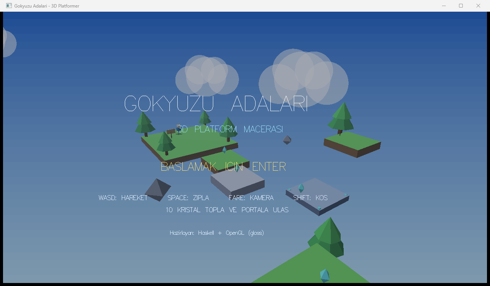
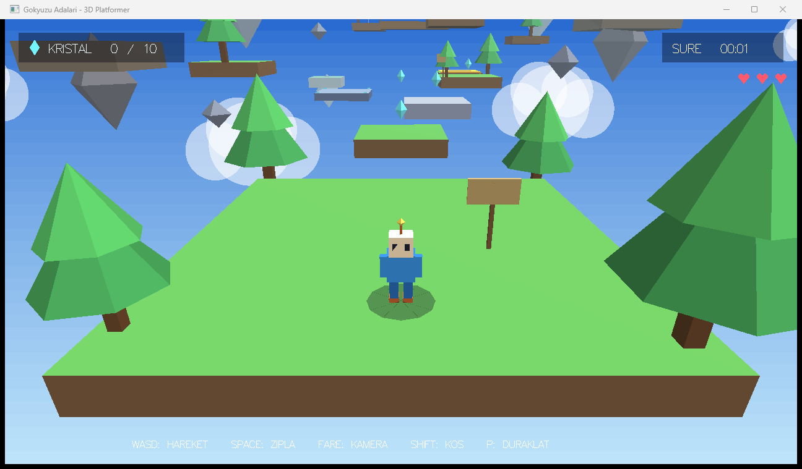
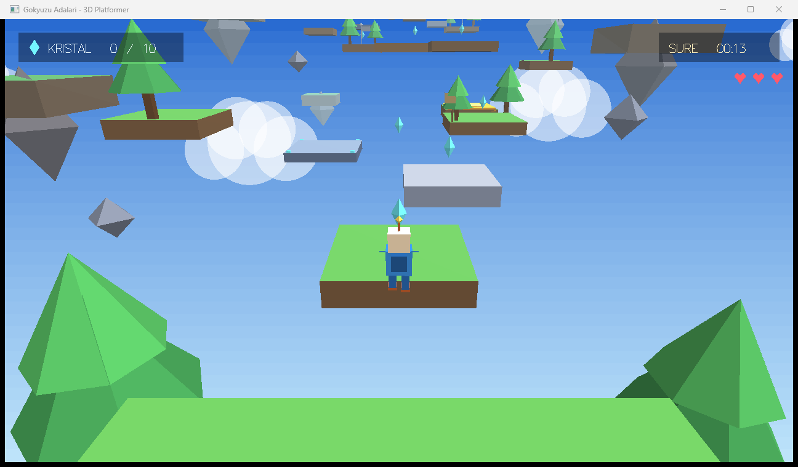

# Gökyüzü Adaları — 3D Platform Macerası

> Haskell ile sıfırdan yazılmış, kendi yazılım 3D boru hattına sahip bir platform oyunu.
> Harici bir oyun motoru yok: ne Unity, ne Godot, ne OpenGL sahne grafiği — sadece saf matematik ve `gloss`.

[](https://github.com/HiX5eT/H-Platformer/actions/workflows/build.yml)
[-2ea44f?logo=windows)](https://github.com/HiX5eT/H-Platformer/releases/latest)
[](https://www.haskell.org/)
[](https://hackage.haskell.org/package/gloss)
[](LICENSE)
[]()

<p align="center">
  
  
</p>
<p align="center">
  
</p>

---

## Oyun hakkında

Gökyüzünde süzülen adalarda geçen bir 3D platform macerası. **10 kristali** topla, hareketli
platformları ve trambolinleri kullanarak ilerle ve son adadaki **portala** ulaş.

Yol boyunca iki kontrol noktası var: birine dokunduğunda tekrar doğma noktan oraya taşınır.
Boşluğa düşmek bir can götürür — toplam **3 canın** var.

### Öne çıkanlar

| | |
|---|---|
| 🧊 **Kendi 3D motoru** | `gloss` yalnızca 2D çokgen çizer. Dünya üçgenleri → kamera uzayı → yakın düzlem kırpma → perspektif projeksiyon → derinliğe göre sıralı çizim hattı bu projede yazıldı. |
| 🎮 **Sağlam platformer fiziği** | 120 Hz sabit adımlı AABB çarpışması, eksen-ayrı çözümleme, coyote time, zıplama tamponu. |
| 🪂 **Çift zıplama** | Havadayken ikinci kez SPACE'e basarak yükseklik kazan. |
| 📏 **Değişken zıplama** | SPACE'i erken bırakırsan daha alçak, basılı tutarsan daha yüksek zıplarsın. |
| 🎪 **Hareketli dünya** | Yatay/dikey hareketli platformlar oyuncuyu taşır; trambolinler yükseğe fırlatır. |
| ⚠️ **Tehlikeler** | Kırmızı tehlike plakaları can götürür, boşluklar tekrar doğmaya yol açar. |
| 🖥️ **HUD ve ekranlar** | Kristal sayacı, süre, can göstergesi, duraklatma, kazanma/kaybetme ekranları. |
| 🐞 **Hata ayıklama katmanı** | `F` ile konum, hız, zemin, zıplama hakkı, kamera açıları ve fizik adımı anlık izlenebilir. |

---

## Kontroller

| Tuş | İşlev |
|---|---|
| `W` `A` `S` `D` / Ok tuşları | Hareket |
| `SPACE` | Zıpla (havada tekrar bas → çift zıplama) |
| `SHIFT` | Koş |
| Fare (basılı tutup sürükle) | Kamerayı döndür |
| `Q` / `E` | Kamerayı sola / sağa çevir |
| `P` / `ESC` | Duraklat |
| `R` | Bölümü baştan başlat |
| `F` | Hata ayıklama katmanını aç / kapat |
| `M` | Sesi aç / kapat |

---

## Kurulum

### Hızlı başlangıç (Windows, derleme yok)

Hazır derlenmiş sürümü [Releases](https://github.com/HiX5eT/H-Platformer/releases/latest)
sayfasından indirin, bir klasöre çıkarın ve `oyna.bat` dosyasını çalıştırın.
`freeglut.dll` paketin içinde gelir.

### Gereksinimler

- [GHC](https://www.haskell.org/ghcup/) 9.4 veya üzeri (9.10.3 ile test edildi)
- [cabal](https://cabal.readthedocs.io/) 3.x
- `freeglut` kütüphanesi (Windows'ta `freeglut.dll`, Linux'ta `freeglut3`)

### Windows

```bat
git clone https://github.com/HiX5eT/H-Platformer.git
cd H-Platformer

derle.bat    :: cabal build + exe'yi ve DLL'i doğru yere kopyalar
oyna.bat     :: oyunu başlatır
```

`freeglut.dll` sistemde yoksa [freeglut releases](https://github.com/freeglut/freeglut/releases)
sayfasından indirip proje köküne koyun — `derle.bat` onu exe'nin yanına kopyalar.

### Linux / macOS

```bash
sudo apt install freeglut3-dev      # Debian/Ubuntu
brew install freeglut               # macOS

cabal build
cabal run platformer
```

### Elle derleme

```bash
cabal build
cabal run platformer
```

---

## Proje yapısı

```
.
├── app/
│   └── Main.hs           # Giriş noktası — gloss playIO, 1280×720 pencere
├── src/Game/
│   ├── Math.hs           # V3 vektör ve M4 4×4 matris işlemleri
│   ├── Types.hs          # Solid, Player, World, Camera veri tipleri
│   ├── Level.hs          # Bölüm yerleşimi: platformlar, kristaller, kontrol noktaları
│   ├── Physics.hs        # AABB çarpışma, eksen-ayrı çözüm, zıplama mantığı
│   ├── Render.hs         # 3D → 2D boru hattı, gökyüzü, modeller, HUD, ekranlar
│   └── Update.hs         # Olay işleme, 120 Hz fizik döngüsü, kamera, oyun kuralları
├── docs/screenshots/     # README görselleri
├── platformer.cabal
├── derle.bat / oyna.bat  # Windows kolaylık betikleri
└── LICENSE
```

---

## Teknik notlar

### 1. Yazılım tabanlı 3D boru hattı

`gloss` yalnızca düz çokgen çizebildiği için her kare şu adımlardan geçiyor:

```
dünya uzayı üçgenleri
      │  model → dünya dönüşümü
      ▼
kamera uzayı  (look-at matrisi)
      │  yakın düzlem kırpma (near-plane clipping)
      ▼
perspektif projeksiyon  (görüş alanı + en-boy oranı)
      │  ekran uzayına ölçekleme
      ▼
derinliğe göre sıralı çizim  (ressam algoritması)
```

Z-buffer olmadığı için çizim sırası kritik: üçgenler ortalama derinliğe göre sondan başa
sıralanıp çiziliyor. Yüzey aydınlatması, yüzey normali ile ışık yönünün nokta çarpımından
hesaplanıyor; sis ve gökyüzü gradyanı derinliğe bağlı olarak karıştırılıyor.

### 2. Fizik

- **Sabit adım:** kare süresinden bağımsız 1/120 s fizik adımı, biriktiricili döngü
  (`wAcc`) ile — yavaş karelerde bile hareket hızı değişmiyor.
- **Çarpışma:** her eksen ayrı çözülüyor (X → Z → Y). Bu, köşelere takılmayı ve
  platform kenarlarına "yapışmayı" engelliyor.
- **Zıplama:** `coyote time` (yerden ayrıldıktan kısa süre sonra hâlâ zıplayabilme) ve
  `jump buffer` (inişten hemen önce basılan tuşu hatırlama) ile hissiyat yumuşatıldı.
- **Değişken yükseklik:** tuş bırakıldığında dikey hız `× 0.55` ile kısaltılıyor.
- **Hareketli platformlar:** taşıyıcı platformun delta'sı oyuncuya eklenerek gerçek
  "üzerinde durma" davranışı elde ediliyor.

### 3. Neden gloss?

Haskell ekosisteminde hızlı prototipleme için en pratik pencere/olay katmanı gloss.
Sahne grafiği yerine kendi boru hattını yazmak, 3D matematiğin (matrisler, kırpma,
projeksiyon) her satırının görünür ve kontrol edilebilir olmasını sağladı.

---

## Yol haritası

- [ ] Ses efektleri ve müzik (şu an `M` tuşu yer tutucu)
- [ ] İkinci bölüm ve boss karşılaşması
- [ ] Gölge ve z-buffer tabanlı çizim
- [ ] Oyun kolu desteği
- [ ] Seviye düzenleyici (JSON tabanlı bölüm tanımı)

---

## Katkı

Hata bildirimi ve öneriler için *issue* açabilirsiniz. Kod katkısı için:

```bash
git checkout -b ozellik/yeni-bolum
cabal build      # -Wall altında uyarısız derlenmeli
git commit -m "Yeni bölüm eklendi"
git push origin ozellik/yeni-bolum
```

---

## Lisans

[BSD 3-Clause](LICENSE) © 2026 Eren

---

<details>
<summary><b>English summary</b></summary>

**Gökyüzü Adaları (Sky Islands)** is a 3D platformer written entirely in Haskell on top of
`gloss`. Since gloss only draws 2D polygons, the project implements its own software 3D
pipeline: world-space triangles → view space → near-plane clipping → perspective projection
→ depth-sorted polygon rendering (painter's algorithm).

Gameplay: collect 10 crystals across floating islands, ride moving platforms and trampolines,
reach the portal. Physics run at a fixed 120 Hz with per-axis AABB collision, coyote time,
jump buffering, variable jump height and double jumping.

Build with `cabal build && cabal run platformer`. On Windows, place `freeglut.dll` next to
the executable (or just run `derle.bat`).

</details>
